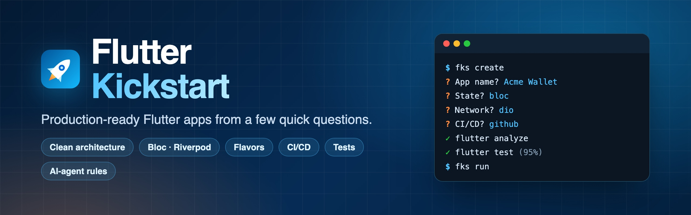

<p align="center">
  <a href="https://alamin-karno.github.io/flutter-kickstart/">
    
  </a>
</p>

<h1 align="center">Flutter Kickstart</h1>

<p align="center">
  <b>Create a production-ready Flutter app from a few quick questions.</b><br>
  Flavors, clean architecture, Bloc or Riverpod, networking, tests, CI/CD and AI-agent rules,<br>
  already passing <code>flutter analyze</code> and <code>flutter test</code>.
</p>

<p align="center">
  <a href="https://github.com/alamin-karno/flutter-kickstart/releases/latest"></a>
  <a href="https://github.com/alamin-karno/flutter-kickstart/actions/workflows/ci.yml"></a>
  <a href="https://alamin-karno.github.io/flutter-kickstart/"></a>
  <a href="LICENSE"></a>
  <a href="https://github.com/alamin-karno/flutter-kickstart/stargazers"></a>
</p>

<p align="center">
  <a href="https://alamin-karno.github.io/flutter-kickstart/"><b>Documentation</b></a> ·
  <a href="https://alamin-karno.github.io/flutter-kickstart/guide/quick-start">Quick start</a> ·
  <a href="https://alamin-karno.github.io/flutter-kickstart/app/overview">What you get</a> ·
  <a href="CONTRIBUTING.md">Contributing</a> ·
  <a href="CHANGELOG.md">Changelog</a>
</p>

---

Every new Flutter project starts the same way: flavors, architecture,
dependency injection, a network layer, routing, theming, localization, tests
and CI. That takes days, and every project ends up a little different.

**Flutter Kickstart does it in minutes, the same way every time.** Answer a
few questions in your terminal, or ask your AI agent in plain words, and get a
Flutter app that is ready for real work. It works with **Claude Code, Cursor,
Windsurf, Antigravity, Codex, Gemini CLI and GitHub Copilot**.

## Quick start

```bash
# 1. Install (once)
curl -fsSL https://raw.githubusercontent.com/alamin-karno/flutter-kickstart/main/install.sh | bash

# 2. Create an app (answer a few questions; press Enter for the default)
fks create

# 3. Run it
cd my_app && fks run
```

On Windows (PowerShell):

```powershell
irm https://raw.githubusercontent.com/alamin-karno/flutter-kickstart/main/install.ps1 | iex
```

Or skip the CLI and ask your agent:
*"Create a new Flutter app called Acme Wallet for com.acme."*

> **Needs:** Flutter (or [fvm](https://fvm.app)), Python 3.8+, git. For iOS: macOS and Xcode.
> [Very Good CLI](https://cli.vgv.dev) is installed for you on first use.

## Why Flutter Kickstart?

- **Checks its own work.** It only reports success after `flutter analyze` and `flutter test` pass, and the coverage floor is met.
- **Same answers, same app.** Your answers drive a deterministic generator, so every teammate and every agent gets the same project.
- **Asks instead of guessing.** Bloc or Riverpod, viva_network_kit or plain Dio: you choose each time.
- **Keeps AI agents on track.** Every app ships `AGENTS.md` and project skills, so your agent follows the same rules after day one.
- **No lock-in.** The output is a normal Flutter project. Even the feature generator is copied into the app.

## What you get

| Area | Generated |
| --- | --- |
| **Base** | Very Good CLI app with native development/staging/production flavors, `very_good_analysis` lints, l10n in English plus any extra languages |
| **Architecture** | `lib/core/` contracts + `lib/features/<name>/{domain,data,presentation}` |
| **State** | Bloc/Cubit (`get_it` + `injectable`) or Riverpod (`riverpod_generator`) |
| **Network** | `AppApiClient` on viva_network_kit or plain Dio, sealed `AppFailure`, `Either` everywhere, auth and logging interceptors |
| **App shell** | `go_router`, Material 3 light/dark theme with tokens, `AppLogger`, `CrashReporter` (console, Sentry or Crashlytics), per-flavor config |
| **Tests** | Unit, DI, state and widget tests (about 95% coverage) and `scripts/quality_gate.sh` |
| **CI/CD** | Optional GitHub Actions for PR checks, Android and iOS builds and store uploads, plus Fastlane and a setup guide |
| **AI layer** | `AGENTS.md`, `CLAUDE.md`, `GEMINI.md`, 10 project skills, Cursor and Windsurf rules, Copilot instructions, reviewer subagents |

Read more: [Architecture](https://alamin-karno.github.io/flutter-kickstart/app/architecture) ·
[Networking](https://alamin-karno.github.io/flutter-kickstart/app/networking) ·
[Testing](https://alamin-karno.github.io/flutter-kickstart/app/testing) ·
[CI/CD](https://alamin-karno.github.io/flutter-kickstart/app/ci-cd) ·
[AI layer](https://alamin-karno.github.io/flutter-kickstart/app/ai-layer)

## The `fks` command

`fks` is short for **f**lutter **k**ick**s**tart (like `fvm` for Flutter
Version Manager). `flutter-kickstart` works too.

| Command | What it does |
| --- | --- |
| `fks create` | Asks the questions, generates the app, checks it with `flutter analyze` + `flutter test` |
| `fks create --yes` | Asks only name, org and state management; uses defaults for the rest |
| `fks create --name x --org com.acme --state bloc ...` | No questions; [takes generator flags](https://alamin-karno.github.io/flutter-kickstart/reference/flags) |
| `fks run [flavor]` | Runs a flavor (default `development`); uses fvm if pinned |
| `fks add-feature orders` | Adds a feature with every layer, DI, route, l10n and tests |
| `fks doctor` | Checks Python, Flutter, git and Very Good CLI |
| `fks update` | Gets the latest release |
| `fks uninstall` | Removes the command and the agent skills |

## Setup questions

Most have a default; press Enter to accept it, or pass the flag to skip the question.

| # | Question | Flag | Default |
| - | --- | --- | --- |
| 1 | App display name and description | `--app-name`, `--description` | from `--name` |
| 2 | Package name | `--name` | snake_case of the display name |
| 3 | Organization / reverse domain | `--org` | required |
| 4 | Platforms | `--platforms` | `android,ios` |
| 5 | State management | `--state bloc\|riverpod` | always asked |
| 6 | Network client | `--network viva\|dio` | `viva`, always asked |
| 7 | API base URL per flavor | `--base-url flavor=url` | placeholders |
| 8 | Starter features beyond home | `--features auth,orders` | none |
| 9 | Languages besides English | `--locales en,bn` | `en` |
| 10 | Crash reporting | `--crash none\|sentry\|crashlytics` | `none` |
| 11 | CI/CD | `--ci github\|none` | `github` |
| 12 | Minimum test coverage (%) | `--coverage-floor` | `80` |
| 13 | Figma file link | `--figma-url` | none |
| 14 | AI tools the team uses | `--agents` | `all` |

What each choice changes is explained in
[the setup questions guide](https://alamin-karno.github.io/flutter-kickstart/guide/setup-questions).

## Other ways to install

**Claude Code plugin**

```text
/plugin marketplace add alamin-karno/flutter-kickstart
/plugin install flutter-kickstart@flutter-kickstart
```

**From a clone** (to change the templates, or for agents that ignore symlinks)

```bash
git clone https://github.com/alamin-karno/flutter-kickstart.git ~/flutter-kickstart
~/flutter-kickstart/install.sh               # symlinks; `fks update` keeps them current
~/flutter-kickstart/install.sh --copy        # real copies
~/flutter-kickstart/install.sh --skills-only # skills only, no `fks` command
~/flutter-kickstart/install.sh --uninstall
```

The installer links the skills into each agent's global folder: Claude Code
(`~/.claude/skills`), Cursor (`~/.cursor/skills`), Windsurf
(`~/.codeium/windsurf/skills`), Antigravity (`~/.gemini/config/skills`),
Codex (`~/.codex/skills`), Gemini CLI (`~/.gemini/skills`) and the shared
`~/.agents/skills`. Start a **new** agent session after installing.
[Full install guide](https://alamin-karno.github.io/flutter-kickstart/guide/installation).

> Installs and `fks update` always use the `main` branch, which only holds
> released versions.

## Contributing

Contributions are welcome. Please read [CONTRIBUTING.md](CONTRIBUTING.md) first.

In short: branch from `dev` (`feature/...`, `fix/...`), open a pull request
into `dev`, and keep CI green. Releases go from `dev` to `main` through a
`release/x.y.z` branch and get a `vX.Y.Z` tag. Nobody pushes to `dev` or
`main` directly. See [Branches and releases](https://alamin-karno.github.io/flutter-kickstart/contributing/git-flow).

- [Report a bug](https://github.com/alamin-karno/flutter-kickstart/issues/new?template=bug_report.yml)
- [Request a feature](https://github.com/alamin-karno/flutter-kickstart/issues/new?template=feature_request.yml)
- [Security policy](SECURITY.md) · [Code of Conduct](CODE_OF_CONDUCT.md)

## License

[MIT](LICENSE) © Md. Al-Amin

<p align="center">
  If Flutter Kickstart saves you time, please ⭐ the repo. It helps others find it.
</p>
